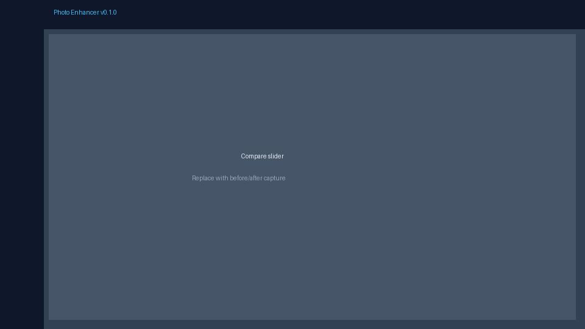

# Photo Enhancer

**v0.1.5 beta** — Local AI photo studio for Windows. Background removal, object removal, upscale, portrait retouch, and 30+ creative filters. **100% offline by default.** No account, no credits, no cloud upload.

Personal project — see [ABOUT.md](ABOUT.md) for motivation, limits, and roadmap.

## Screenshots

| Main editor | Before / after compare |
|-------------|------------------------|
|  |  |

Placeholders above — replace with real captures (see [docs/screenshots/README.md](docs/screenshots/README.md)).

## Feature highlights

| Area | Highlights |
|------|------------|
| **Enhance** | BiRefNet / BRIA background removal, SAM + local PowerPaint/SDXL/LaMa object removal, Real-ESRGAN 2×/4× upscale |
| **Edit** | Compare slider, undo/redo, crop & rotate, bokeh, clone stamp, prism / vignette / grain, AI repair |
| **Portrait** | Magic preset, frequency-separation skin smooth, teeth whitening, simple hair tint & lip/blush |
| **Looks** | 30 filter presets with thumbnail gallery |
| **Batch** | Folder batch (auto enhance, portrait magic, photo restore) |
| **AI Chat** | Rule-based (offline) → Ollama (offline) → OpenAI (opt-in cloud) |
| **Desktop** | PyInstaller + WebView2 `.exe`; models download once to `%APPDATA%\PhotoEnhancer\models\` |

## Privacy-first

- Photos stay on your machine unless you explicitly configure OpenAI for chat.
- Models download once to `%APPDATA%\PhotoEnhancer\models\`.
- No telemetry, no ads, no subscription.

## Quick start

### Windows desktop app (recommended)

Pre-built binary (not in git — build locally or download from a [GitHub Release](docs/RELEASE.md)):

```
dist\PhotoEnhancer\PhotoEnhancer.exe
```

Build it yourself:

```bat
build.bat
```

Output: `dist\PhotoEnhancer\PhotoEnhancer.exe`

### Browser launcher

```bat
start.bat
```

Or:

```bash
python launcher.py
```

Opens **http://127.0.0.1:8000** after building the frontend on first run.

### Dev mode

```bash
# Terminal 1 — backend
cd backend
python -m venv venv
venv\Scripts\activate          # Windows
pip install -r requirements.txt
uvicorn main:app --reload --port 8000

# Terminal 2 — frontend
cd frontend
npm install
npm run dev
```

Open http://localhost:5173

### Manual production build (frontend only)

```bash
cd frontend
npm install
npm run build
```

Then run the backend and open http://127.0.0.1:8000

## System requirements

| | Minimum | Recommended |
|---|---------|-------------|
| OS | Windows 10/11 (64-bit) | Windows 11 |
| RAM | 8 GB | 16 GB+ |
| Disk | 10 GB free (for AI models) | 20 GB+ |
| GPU | Optional (CPU works) | NVIDIA CUDA for faster AI |
| Runtime | WebView2 (pre-installed on Windows 11) | Latest WebView2 runtime |
| Network | Internet required only for initial model download | Stable broadband for first setup |

## First run

On first launch, Photo Enhancer shows a welcome screen explaining that **AI models download once to your computer (~6–8 GB total)**. After that, **everything works offline** — your photos never leave your device.

You can choose:

- **Download all now** — prefetch every model for the fastest experience afterward
- **Download as I go** — models download automatically the first time you use each feature

Progress appears in the app UI (not just server logs). Open **Models** in the toolbar anytime to check status, disk usage, or download remaining models.

Models are stored in:

```
%APPDATA%\PhotoEnhancer\models\
```

Download diagnostics are written to:

```
%APPDATA%\PhotoEnhancer\logs\download.log
```

## Troubleshooting: models won't download

If **Download all** stalls or fails in the packaged app:

1. **Internet** — HuggingFace and GitHub must be reachable (no captive portal). Try a browser on the same PC.
2. **Firewall / antivirus** — Allow `PhotoEnhancer.exe` outbound HTTPS. SSL inspection often breaks large downloads.
3. **Disk space** — Keep at least **10 GB free** on the drive that holds `%APPDATA%` (usually `C:`).
4. **Permissions** — Models always save under `%APPDATA%\PhotoEnhancer\`, not the install folder. You do **not** need admin rights, but the AppData path must be writable.
5. **Install location** — Prefer a portable folder or `%LOCALAPPDATA%\Programs` over `C:\Program Files` if your IT policy blocks writes. The app writes models to AppData either way.
6. **Logs** — Open `%APPDATA%\PhotoEnhancer\logs\download.log` and retry once; share the last lines if you report a bug.

**v0.1.0 manual workaround:** delete `%APPDATA%\PhotoEnhancer\models\` and `%APPDATA%\PhotoEnhancer\Ultralytics\`, then upgrade to the latest build and choose **Download all now** again. Or use **Download as I go** — each feature pulls only the model it needs.

## Model downloads

Models are **not** in git. First use of each feature triggers download (~200 MB – 1 GB per model, ~6–8 GB total if everything is used). You can also prefetch all models from the in-app **Models** panel.

## Troubleshooting: AI Chat shows "Basic" (not Offline AI)

The chat badge is **Basic** when the backend is the built-in rule parser (`rules`). **Offline AI** needs a local Ollama model.

1. **Install and start Ollama** — [ollama.com](https://ollama.com). On Windows, open the Ollama app or run any `ollama` command so the server is listening on `http://127.0.0.1:11434`.
2. **Pull a chat model** (one-time, ~2 GB):
   ```powershell
   ollama pull llama3.2:3b
   ```
   Any pulled model works on current builds (the app auto-uses the first available model). Older `.exe` builds before the auto-fallback fix require the configured model to match — either pull `llama3.2:3b` or set `OLLAMA_MODEL` (step 3).
3. **Optional `.env`** — copy `.env.example` to `.env` beside `PhotoEnhancer.exe` (packaged app) or the project root (dev). Example if you already use another model:
   ```
   OLLAMA_MODEL=qwen2.5:7b-instruct-q4_K_M
   ```
4. **Restart Photo Enhancer** after Ollama is running. The chat panel rechecks every 15s; refresh the page if needed.
5. **Verify** — with the app running, open `http://127.0.0.1:8000/api/chat/status` in a browser. You want `"backend":"ollama"` and a non-null `"ollama_model"`.

`CHAT_BACKEND=rules` in `.env` forces Basic even when Ollama is available.

## Configuration

Copy `.env.example` to `.env` in the project root (optional):

- `OLLAMA_HOST`, `OLLAMA_MODEL` — local chat LLM
- `OPENAI_API_KEY` — opt-in cloud chat only
- `CHAT_BACKEND=auto|rules|ollama|openai`
- `MAX_OUTPUT_MP` — upscale output cap in megapixels (50–400, default **150**). Override the server default; the in-app **Upscale** tool and **Models** panel let you pick Conservative (100 MP), Standard (150 MP), High (200 MP), or a custom value. Preferences sync to `%APPDATA%\PhotoEnhancer\settings.json` on the desktop app.

## ⚠️ AGPL notice (commercial use)

Object selection uses **Ultralytics** (SAM 2.1 + YOLOv8), which is **AGPL-3.0**. Commercial redistribution may require:

1. Complying with AGPL source-offer requirements, **or**
2. An [Ultralytics enterprise license](https://www.ultralytics.com/license), **or**
3. Replacing SAM/YOLO with permissively licensed alternatives

See [THIRD_PARTY_NOTICES.md](THIRD_PARTY_NOTICES.md) for full attribution.

## Releases

Windows `.exe` bundles are attached to GitHub Releases (too large for the repo). See [docs/RELEASE.md](docs/RELEASE.md).

## License

Application source code: [MIT](LICENSE)

Third-party libraries and AI models: see [THIRD_PARTY_NOTICES.md](THIRD_PARTY_NOTICES.md)

## Contributing

See [CONTRIBUTING.md](CONTRIBUTING.md). Bug reports and PRs welcome.

## Security

- Local-only processing for all image tools.
- OpenAI is opt-in; images are only sent if you set `OPENAI_API_KEY`.
- No hardcoded secrets in the repository — use `.env` (gitignored).

## Object removal (local)

- **Fast** = Quick LaMa (ONNX, ~512px tiles). If you switch the editor to AI Remove while on Fast, generative passes run cheap: 28 diffusion steps, single seed.
- **Balanced** = AI Remove at 40 steps. On **water/sky and indoor/structured scenes it never reaches a generative engine** — those fills come from the classical LaMa / PatchMatch / exemplar path.
- **Best Quality** = the only tier that routes those scenes generatively: **SDXL inpaint** for water/sky, **PowerPaint** erase for indoor/structured, at 48 steps with multi-seed selection, plus PatchMatch texture rescue.
- Best Quality generative routing requires **CUDA and the weights already on disk** (PowerPaint ~6 GB, SDXL Inpaint ~6.5 GB). When they are missing, Best Quality uses the same classical fill instead of starting a multi-GB download mid-edit — the **Models** panel and the removal editor both say so up front.
- Editor workflow: select **one person at a time**, optional **Lock subject** / **Remove others**, brush stroke undo/redo, and on Best Quality a **Quick→Best** progressive preview.
- Eval harness: `backend/scripts/eval_removal_bench.py` (coastal + library gates). Scores write to `backend/scripts/_eval/`.

**Honest quality bar:** this is a privacy-first local Windows editor. We do **not** claim Apple Photos Clean Up parity until coastal/library eval gates pass human review. Results vary by scene, GPU VRAM, and which models you have downloaded — on a CPU-only machine, or with the large inpaint weights missing, every tier ends up on the classical fill.

## What this is not

Generative features (AI expand/replace, face reshape, virtual hairstyles, full makeup, headshots) are **out of scope** for the fully-local promise. Photo Enhancer targets **offline cleanup + portrait-friendly retouch**, not a full Airbrush clone.
